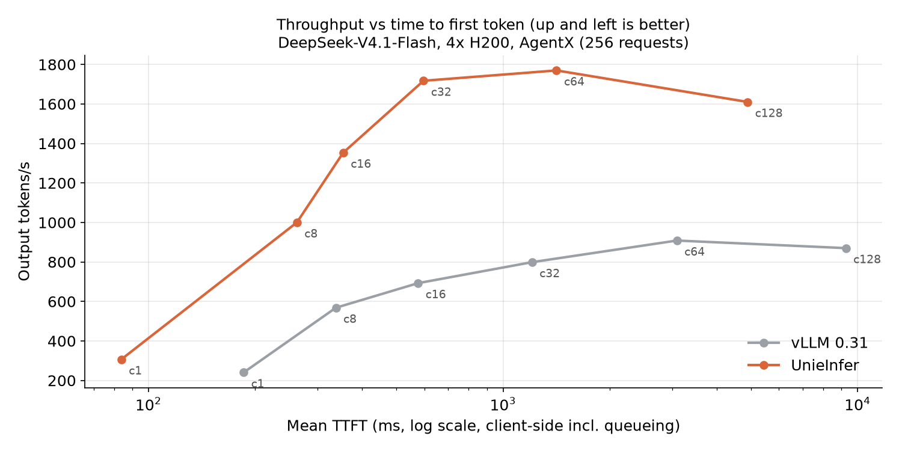
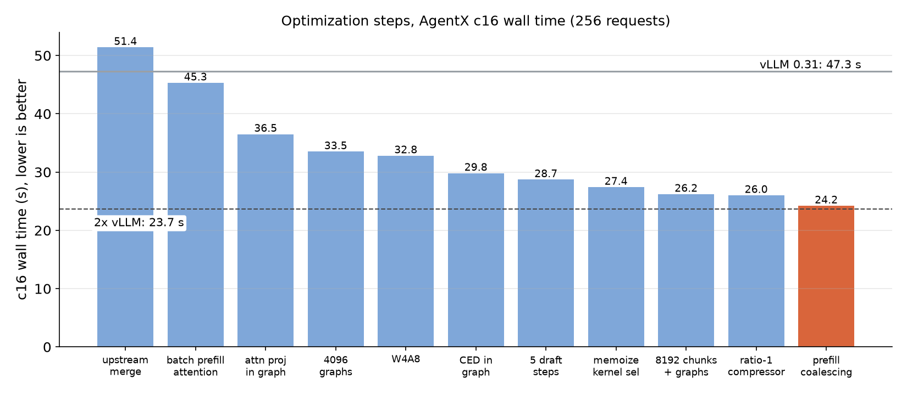
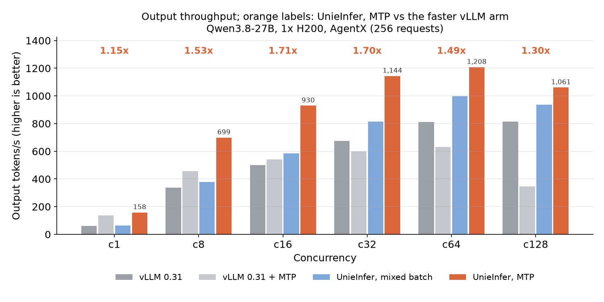
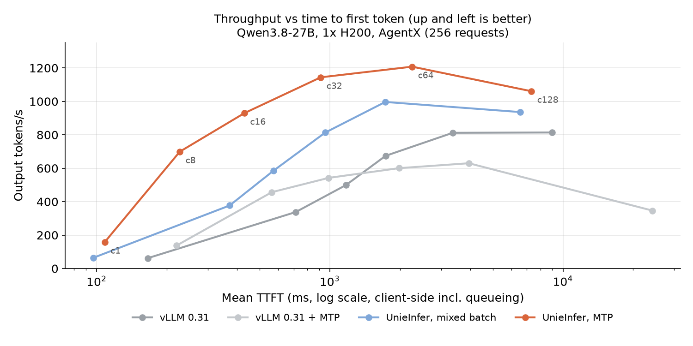
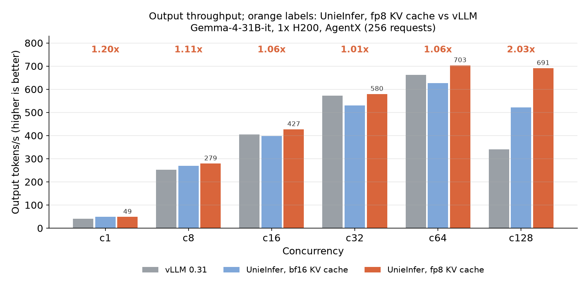
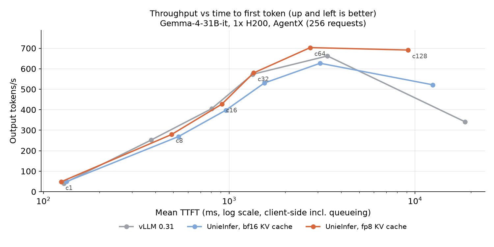

# UnieInfer

UnieInfer is UnieAI's LLM inference engine for **agent workloads**: a fixed
system prompt and tool schemas shared by every request, conversations that grow
turn by turn, and many agents running at once. It is built on
[TokenSpeed](https://github.com/lightseekorg/tokenspeed) from the LightSeek
Foundation and tracks it closely. UnieAI's model support, scheduling and kernel
work sits on top; [UNIEINFER.md](UNIEINFER.md) describes what UnieInfer adds and
how it follows upstream.

Inherited from TokenSpeed:

- **Scheduler**: C++ control plane and Python execution plane. Request
  lifecycle and KV cache ownership are a finite-state machine, and the type
  system checks safe KV reuse at compile time.
- **Kernels**: a pluggable kernel system with a portable public API and a
  central registry, so each platform selects its own implementation.
- **Entrypoint**: an OpenAI-compatible server with low-overhead request
  handling.

## Results at a glance

AgentX agent traces against vLLM 0.31 on H200. Each value is UnieInfer's total
output throughput divided by vLLM's at that concurrency.

| model | hardware | c1 | c8 | c16 | c32 | c64 | c128 |
|---|---|---|---|---|---|---|---|
| [DeepSeek-V4.1-Flash](#deepseek-v41-flash-on-4x-h200) | 4x H200 | 1.28x | 1.76x | 1.95x | **2.15x** | 1.95x | 1.85x |
| [Qwen3.8-27B](#qwen38-27b-on-1x-h200) | 1x H200 | 1.15x | 1.53x | **1.71x** | 1.70x | 1.49x | 1.30x |
| [Gemma-4-31B-it](#gemma-4-31b-it-on-1x-h200) | 1x H200 | 1.20x | 1.11x | 1.06x | 1.01x | 1.06x | 2.03x |

For Qwen3.8, the vLLM figure is the faster of vLLM with and without MTP at each
concurrency.

Some of this work is still under review and not yet merged into `unieai`.
Until it lands, a recipe below needs the branch listed for it:

| work | branch |
|---|---|
| DeepSeek-V4.1 performance and prefill coalescing | `dsv41-perf` (#28; full history in #26) |
| Qwen3.8 MTP | `q38-mtp-fix` (#32) |
| Gemma-4 serving, packed KV, FA4 prefill, fp8 KV cache | `gemma4-serve` |
| Shared-prefix dedup | `sched-shared-prefix` |
| Host L2 on the DMA engines, write-on-evict | `l2-direct-dma`, `l2-write-on-evict` |

## Benchmark setup

**AgentX** is 32 SWE-smith agent sessions × 8 turns: 256 requests with 8k to
10k input tokens each, depending on the tokenizer. Most of each prompt is a
prefix shared within its session. Every request generates exactly 128 tokens.

- Every cell starts from a fresh server, or a flushed prefix cache.
- Wall time is the time to finish all 256 requests.
- TTFT is measured at the client, so it includes queueing.
- Both engines get the same sequence cap: 80 on one H200 and 64 on 4x H200,
  raised to 128 for c128 (and c64 on DeepSeek).

The harness is
[`bench/agent-slo/agentx_sweep.sh`](bench/agent-slo/agentx_sweep.sh).

## DeepSeek-V4.1-Flash on 4x H200

TP4 with expert parallelism and DSpark speculative decoding with 5 draft steps,
on both engines. Values are medians: three runs with swapped arm order for c8
to c32, two runs for the others.


| concurrency | 1 | 8 | 16 | 32 | 64 | 128 |
|---|---|---|---|---|---|---|
| vLLM 0.31 wall (s) | 136.4 | 57.7 | 47.3 | 41.0 | 36.1 | 37.7 |
| **UnieInfer wall (s)** | **106.9** | **32.8** | **24.2** | **19.1** | **18.5** | **20.4** |

- **c16**: UnieInfer serves 634 requests per minute at a mean TTFT of
  354 ms; vLLM serves 325 at 576 ms.
- **c1**: decode speed is at parity, and the lead comes from TTFT (84 ms
  against 186 ms).
- **Accuracy**: GSM8K is 0.9356 on this deployment.



How c16 went from 51.4 s to 24.2 s (vLLM 0.31 takes 47.3 s):



| step | c16 (s) |
|---|---|
| upstream TokenSpeed with DeepSeek-V4.1 support | 51.4 |
| batch prefill attention, fuse the Hopper index top-k glue | 45.3 |
| capture the attention projections in prefill CUDA graphs | 36.5 |
| prefill graphs up to 4096 tokens, W4A8 MoE (FP8 activations) | 32.8 |
| capture the CED narrowing layer around its row selection | 29.8 |
| DSpark speculative decoding with 5 draft steps | 28.7 |
| memoize kernel selection across eager calls | 27.4 |
| 8192-token prefill chunks and graphs, ratio-1 compressor in graph | 26.0 |
| prefill coalescing (`--prefill-coalesce-ms 100`) | **24.2** |

Decode and prefill are now both bound by streaming the routed-expert weights.
The remaining lever is scheduling, so that more tokens share each pass over
those weights.

```bash
unieinfer serve --model deepseek-ai/DeepSeek-V4.1-Flash-1017 --trust-remote-code \
  --tensor-parallel-size 4 --enable-expert-parallel --dtype bfloat16 \
  --speculative-algorithm DSPARK --speculative-num-steps 5 --speculative-num-draft-tokens 6 \
  --moe-mxfp4-fp8-activation --engram-host-table \
  --chunked-prefill-size 8192 --prefill-graph-max-tokens 8192 \
  --max-num-seqs 64 --max-cudagraph-capture-size 64 \
  --prefill-coalesce-ms 100 --gpu-memory-utilization 0.90 \
  --reasoning-parser deepseek_v31
```

`--prefill-coalesce-ms` holds a new request for up to that many milliseconds
while others are decoding, so requests that arrive close together share one
prefill step. A request that arrives while the engine is idle is never held.

## Qwen3.8-27B on 1x H200

UnieInfer runs MTP with 3 draft steps. MTP cannot be combined with mixed
batching on this model: a mixed pass would fold rejected draft tokens into the
linear-attention state, so the engine refuses that combination at startup.
vLLM is shown both without and with MTP (`num_speculative_tokens: 3`).



| output tok/s | c1 | c8 | c16 | c32 | c64 | c128 |
|---|---|---|---|---|---|---|
| vLLM 0.31 | 61.6 | 337.9 | 500.0 | 674.2 | 812.1 | 813.9 |
| vLLM 0.31 + MTP | 137.3 | 456.8 | 542.3 | 600.5 | 629.9 | 346.3 |
| UnieInfer, mixed batch | 64.1 | 376.9 | 585.2 | 813.3 | 996.6 | 936.2 |
| **UnieInfer, MTP** | **158.2** | **699.0** | **929.6** | **1144.1** | **1207.8** | **1060.8** |

At c64, UnieInfer with MTP has a mean TTFT of 2.26 s and a TPOT of 34.6 ms.
The faster vLLM arm has 3.37 s and 52.6 ms. vLLM with MTP falls behind
plain vLLM from c32 up.



```bash
unieinfer serve --model Qwen/Qwen3.8-27B --trust-remote-code --tp 1 \
  --speculative-algorithm MTP --speculative-num-steps 3 --speculative-num-draft-tokens 4 \
  --block-size 64 --chunked-prefill-size 8192 --max-prefill-tokens 8192 --prefill-graph-max-tokens 8192 \
  --max-num-seqs 80 --max-model-len 32768 --gpu-memory-utilization 0.90 --disable-kvstore
```

## Gemma-4-31B-it on 1x H200

Three changes make UnieInfer's KV cache fit Gemma-4:

- Gemma-4's per-layer KV geometry is packed onto one plane, which doubles the
  KV capacity.
- Its 512-wide global layers prefill with FA4.
- An optional fp8 KV cache reads its pages with an unquantized query
  wherever a kernel can. It also folds the model's constant `k_norm` scale
  into the softmax scale.



| output tok/s | c1 | c8 | c16 | c32 | c64 | c128 |
|---|---|---|---|---|---|---|
| vLLM 0.31 | 40.6 | 251.8 | 404.9 | 573.0 | 662.4 | 341.2 |
| UnieInfer, bf16 KV cache | 49.2 | 268.8 | 397.7 | 530.2 | 626.8 | 521.5 |
| **UnieInfer, fp8 KV cache** | **48.6** | **279.1** | **427.2** | **579.5** | **703.2** | **691.3** |

- **c16 to c64**: the lead is within about 6%. Gemma-4 at bf16 is close to
  this H200's limit for the trace (about 44 s wall at c64), so the next lever
  is fp8 weights.
- **c128**: the 2x comes from vLLM's throughput falling.
- **Accuracy**: on the fp8 cache, GSM8K is 0.9697 (0.9712 on bf16).
  Multi-needle retrieval in 8k/16k/28k agentic haystacks scores
  0.985/0.985/0.985, against 0.980/0.990/0.985 on bf16.



```bash
unieinfer serve --model google/gemma-4-31B-it --trust-remote-code --tp 1 \
  --kv-cache-dtype fp8_e4m3 --block-size 64 --enable-mixed-batch \
  --chunked-prefill-size 8192 --max-prefill-tokens 8192 --prefill-graph-max-tokens 8192 \
  --max-num-seqs 80 --max-model-len 32768 --gpu-memory-utilization 0.90 --disable-kvstore
```

## Shared-prefix dedup

Agent traffic is full of prompts that share a long prefix and arrive together:
the samples of one RL rollout, the sub-calls an agent fans out, the questions
asked of one document. A plain prefix cache only helps a prompt that arrives
after the prompt it shares with has finished. UnieInfer's scheduler also reuses
a prefix between prompts that are waiting or still being computed, on every
model family. Two rules do it:

- A waiting prompt whose next uncached pages another prompt is computing
  waits a round for them, instead of computing them again.
- Some models keep history only where a chunk ends: sliding-window layers,
  and recurrent-state layers, which keep it as a state checkpoint. On those
  models a first chunk ends where the waiting prompts branch off, so the
  shared part stays hittable.

Wall time in seconds, dedup off → on, on one H200 at c64, with 256 requests
per workload and the cache flushed before each. Speedup is in parentheses.

| model | agentx | n-sample | doc-QA | agent | mixed |
|---|---|---|---|---|---|
| Gemma-4-31B-it (sliding window) | 60.1 → 53.5 (1.12x) | 56.6 → 43.3 (1.31x) | 97.8 → 75.9 (1.29x) | 91.3 → **40.5** (2.25x) | 131.3 → 101.8 (1.29x) |
| Qwen3.8-27B (linear attention) | 32.6 → 33.1 (0.99x) | 55.7 → **33.0** (1.69x) | 56.5 → 53.8 (1.05x) | 45.9 → **29.9** (1.53x) | 74.2 → 61.9 (1.20x) |
| Qwen3.6-35B-A3B (linear attention, MoE) | 12.8 → 14.7 (0.87x) | 15.6 → 10.7 (1.46x) | 18.0 → 18.0 (1.00x) | 79.2 → **11.8** (6.72x) | 20.3 → 18.0 (1.13x) |
| Qwen3-8B (full attention) | 18.9 → 18.6 (1.02x) | 19.0 → 15.8 (1.20x) | 26.7 → 25.9 (1.03x) | 19.0 → 16.2 (1.17x) | 25.2 → 23.5 (1.07x) |

Workloads:
- **n-sample**: 32 prompts of about 6k tokens, 8 samples each.
- **doc-QA**: 16 documents of 12k tokens, 16 questions each.
- **agent**: a 4k shared prompt, then 32 sessions of 3k tokens, each fanning
  out to 8 sub-calls.
- **mixed**: the three above, interleaved. It is the mean of two runs; every
  other cell is one run.

Dedup is faster in 17 of 20 cases. The two AgentX cases on linear-attention
models are open work.

Dedup is on by default. `--inflight-prefix-defer-pages 0` turns it off; the
number is the fewest shared pages worth waiting for, default 4. To watch it:

- Every `Prefill batch.` / `Mix batch.` log line ends with
  `prefix reuse(last 256/all): 86.3%/83.1%, dedup(deferred/rounds/cut): 23/32/31`.
  - The reuse figures are cached over prompt tokens at admission, for the
    last 256 prompts and since start.
  - The dedup figures count the prompts that waited for an in-flight prefix,
    the rounds they waited, and the chunks cut at a branch point.
- With `--enable-metrics`, Prometheus has the reuse ratio as
  `tokenspeed:prefix_cache_hits_total / tokenspeed:prompt_tokens_total`. The
  dedup activity is in `tokenspeed:prefix_dedup_deferred_requests_total`,
  `tokenspeed:prefix_dedup_deferred_rounds_total` and
  `tokenspeed:prefix_dedup_cut_chunks_total`.

## Host L2 KV tier

The Host L2 copies KV cache to CPU memory, so that a prefix evicted from the
GPU can be copied back instead of recomputed. That only pays off when the GPU
cache overflows and an evicted prefix is needed again.

Across the four models and five workloads above:
- Gemma-4 mixed is the only case that read data back. There the L2 was 21%
  faster.
- Every other case only paid the copy cost, 12% at the median.

Until the Host L2 work under review lands, serve with `--disable-kvstore`, as
in the recipes above.

## Getting started

UnieInfer installs, launches and is configured the same way as TokenSpeed.
`unieinfer`, `tokenspeed` and `ts` are the same command. The upstream
documentation applies:

- [Getting Started](https://lightseek.org/tokenspeed/guides/getting-started)
- [Launching a Server](https://lightseek.org/tokenspeed/guides/launching)
- [Model Recipes](https://lightseek.org/tokenspeed/recipes/models)
- [Server Parameters](https://lightseek.org/tokenspeed/configuration/server)
- [Parallelism](https://lightseek.org/tokenspeed/serving/parallelism)

In-repo docs live under [`docs/`](docs/).

## Built on TokenSpeed

UnieInfer regularly merges upstream TokenSpeed, which the
[LightSeek Foundation](https://lightseek.org/) develops and releases under the
MIT license (see [LICENSE](LICENSE)). Fixes that belong upstream go back
upstream. For upstream news and the design behind the engine, see the
[TokenSpeed repository](https://github.com/lightseekorg/tokenspeed) and the
[LightSeek blog](https://lightseek.org/blog/). When citing the engine design,
please cite TokenSpeed:

```bibtex
@misc{tokenspeed2026,
  author       = {{TokenSpeed Team}},
  title        = {{TokenSpeed}: A Speed-of-Light {LLM} Inference Engine},
  year         = {2026},
  howpublished = {\url{https://github.com/lightseekorg/tokenspeed}}
}
```
