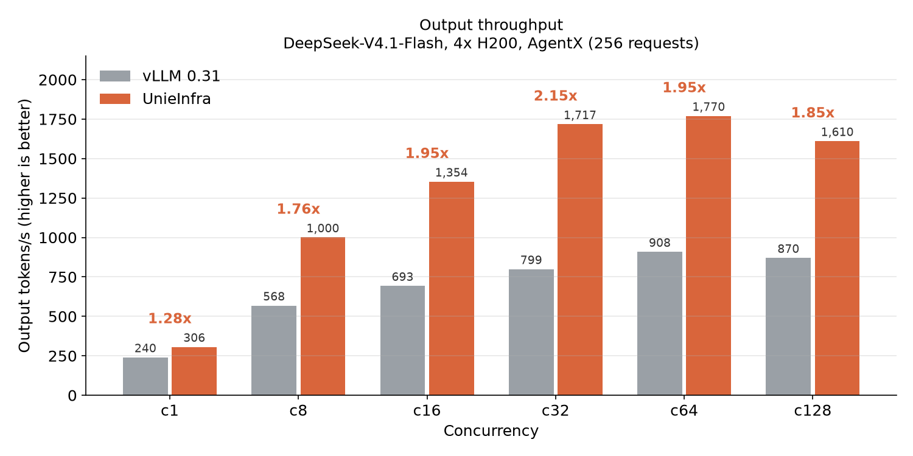

# UnieInfra

UnieInfra is UnieAI's LLM inference engine for **agent workloads**: a fixed
system prompt and tool schemas shared by every request, conversations that grow
turn by turn, and many agents running at once. It is built on
[TokenSpeed](https://github.com/lightseekorg/tokenspeed) and tracks it
closely, adding UnieAI's model support, scheduling and kernel work on top.

- **Scheduler**: C++ control plane and Python execution plane. Request
  lifecycle and KV cache ownership are a finite-state machine, with safe KV
  reuse enforced by the type system at compile time.
- **Kernels**: a pluggable kernel system with a portable public API and a
  central registry, so each platform selects its own implementation.
- **Entrypoint**: an OpenAI-compatible server with low-overhead request
  handling.

## What we are working on

**DeepSeek-V4.1-Flash on 4x H200 for agent serving.** The target is twice the
throughput of vLLM 0.31 on AgentX agent traces at the same hardware, without
giving up accuracy. It is reached at concurrency 32 (2.15x); concurrency 16 is
at 1.95x.

What got it there, in order (c16 wall time, vLLM 0.31 takes 47.3 s):

| step | c16 (s) |
|---|---|
| upstream TokenSpeed with DeepSeek-V4.1 support | 51.4 |
| batch prefill attention, fuse the Hopper index top-k glue | 45.3 |
| capture the attention projections in prefill CUDA graphs | 36.5 |
| prefill graphs up to 4096 tokens, W4A8 MoE (FP8 activations) | 32.8 |
| capture the CED narrowing layer around its row selection | 29.8 |
| DSpark speculative decoding with 5 draft steps | 28.7 |
| memoize kernel selection across eager calls | 27.4 |
| 8192-token prefill chunks and graphs, ratio-1 compressor in graph | 26.0 |
| prefill coalescing (`--prefill-coalesce-ms 100`) | **24.2** |


Both decode and prefill are now bound by streaming the routed-expert weights,
so the remaining lever is scheduling: letting more tokens share each pass over
those weights. Next is closing the last 2% at concurrency 16.

**Never computing a shared prefix twice.** Agent traffic is full of prompts
that share long prefixes and arrive together: the samples of one RL rollout,
the sub-calls an agent fans out, the questions asked of one document. A plain
prefix cache only helps a prompt that arrives after the one it shares with has
finished. The scheduler now also reuses prefixes between prompts that are
waiting or still being computed, on every model family; see
[Shared-prefix workloads](#shared-prefix-workloads).

**Gemma-4-31B and Qwen3.8-27B on a single H200.** Gemma-4 is served with its
per-layer KV geometry packed onto one plane, FA4 for its 512-wide global
layers and an optional fp8 KV cache; Qwen3.8 with MTP speculative decoding.

## Performance

### DeepSeek-V4.1-Flash on 4x H200, against vLLM 0.31

AgentX agent traces: 256 requests per cell, about 9.7k input tokens each
(most of it a prefix shared within a session) and exactly 128 output tokens.
The prefix cache is flushed before every cell. Each value is the wall time for
the cell, median over repeated arms run in swapped orders; lower is better.



| concurrency | 1 | 8 | 16 | 32 | 64 | 128 |
|---|---|---|---|---|---|---|
| vLLM 0.31 (s) | 136.4 | 57.7 | 47.3 | 41.0 | 36.1 | 37.7 |
| **UnieInfra (s)** | **106.9** | **32.8** | **24.2** | **19.1** | **18.5** | **20.4** |
| **speedup** | **1.28x** | **1.76x** | **1.95x** | **2.15x** | **1.95x** | **1.85x** |

At concurrency 16, UnieInfra serves 634 requests per minute at a mean TTFT of
354 ms; vLLM serves 325 at 576 ms. GSM8K accuracy is 0.9356 on the same
deployment.


Both engines saturate around concurrency 64. At concurrency 1 decode speed is
at parity, and the lead comes from time to first token (84 ms against 186 ms).

Serving recipe (TP4 with expert parallelism, DSpark speculative decoding):

```bash
ts serve --model deepseek-ai/DeepSeek-V4.1-Flash-1017 --trust-remote-code \
  --tensor-parallel-size 4 --enable-expert-parallel --dtype bfloat16 \
  --speculative-algorithm DSPARK --speculative-num-steps 5 --speculative-num-draft-tokens 6 \
  --moe-mxfp4-fp8-activation --engram-host-table \
  --chunked-prefill-size 8192 --prefill-graph-max-tokens 8192 \
  --max-num-seqs 64 --max-cudagraph-capture-size 64 \
  --prefill-coalesce-ms 100 --gpu-memory-utilization 0.90 \
  --reasoning-parser deepseek_v31
```

`--prefill-coalesce-ms` holds a newly arrived request for up to that many
milliseconds while others are decoding, so requests that arrive close together
share one prefill step. A request that arrives while the engine is idle is
never held. The concurrency 64 and 128 cells ran with `--max-num-seqs 128
--max-cudagraph-capture-size 128`.

### Shared-prefix workloads

Four workloads of 256 requests at concurrency 64, 128 output tokens each, on
one H200: **n-sample** (32 prompts of ~6k tokens, 8 samples each), **agent**
(a 4k shared prompt, 32 sessions of 3k tokens, each fanning out to 8
sub-calls), **doc-QA** (16 documents of 12k tokens, 16 questions each) and
**mixed** (all three interleaved). Wall time with prefix dedup off and on; in
parentheses, the share of the reachable prefix reuse obtained (a page-aligned
prefix shared with any request sent earlier).

| model | n-sample | agent | mixed |
|---|---|---|---|
| Gemma-4-31B (sliding window) | 58.0 → 46.1 s (100%) | 89.8 → **40.7 s** (99%) | 120.9 → 101.6 s (81%) |
| Qwen3.8-27B (linear attention) | 53.9 → **34.9 s** (97%) | 45.1 → **30.1 s** (98%) | 71.6 → 61.8 s (88%) |
| Qwen3.6-35B-A3B (linear attention, MoE) | 15.5 → 11.2 s (97%) | 14.5 → 12.1 s (98%) | 19.9 → 18.1 s (87%) |
| Qwen3-8B (full attention) | 20.3 → 15.9 s (100%) | 19.0 → 16.2 s (100%) | 25.8 → 23.4 s (100%) |

Two rules do it. A waiting prompt whose next uncached pages another prompt is
computing waits a round for them instead of computing them again. And on a
model whose sliding-window or recurrent-state layers keep history only where a
chunk ends, a first chunk ends where the waiting prompts branch off, so the
shared part stays hittable (on recurrent-state layers, as a state checkpoint).
Mixed on Gemma-4 is bound by KV capacity: shared prefixes are evicted before
their next sharer arrives; with `--kv-cache-dtype fp8_e4m3` it runs in 75.8 s
at 92%.

Dedup is on by default; `--inflight-prefix-defer-pages 0` turns it off (the
number is the fewest shared pages worth waiting for, default 4). To watch it:

- every `Prefill batch.` / `Mix batch.` log line ends with
  `prefix reuse(last 256/all): 86.3%/83.1%, dedup(deferred/rounds/cut): 23/32/31`
  -- cached over prompt tokens at admission for the last 256 prompts and since
  start, then how many prompts waited for an in-flight prefix, the rounds they
  waited and the chunks cut at a branch point;
- with `--enable-metrics`, Prometheus has the reuse ratio as
  `tokenspeed:prefix_cache_hits_total / tokenspeed:prompt_tokens_total` and the
  dedup activity as `tokenspeed:prefix_dedup_deferred_requests_total`,
  `tokenspeed:prefix_dedup_deferred_rounds_total` and
  `tokenspeed:prefix_dedup_cut_chunks_total`.

### Gemma-4-31B-it and Qwen3.8-27B on 1x H200, against vLLM 0.31

AgentX agent traces as above (256 requests, about 9.7k input and 128 output
tokens each), one H200, wall time in seconds:

| model | concurrency | vLLM 0.31 | UnieInfra | speedup |
|---|---|---|---|---|
| Gemma-4-31B-it, fp8 KV cache | 16 | 80.9 | **75.6** | 1.07x |
| Gemma-4-31B-it, fp8 KV cache | 64 | 49.1 | **45.9** | 1.07x |
| Qwen3.8-27B, MTP | 16 | 61.2 | **34.5** | **1.77x** |
| Qwen3.8-27B, MTP | 64 | 39.9 | **27.3** | **1.46x** |

Gemma-4 with the bf16 cache takes 81.8 s and 52.3 s. The fp8 cache reads its
pages with an unquantized query wherever a kernel can and folds the model's
constant `k_norm` scale into the softmax scale, so keys are cached at unit
RMS. GSM8K is 0.9697 on it against 0.9712 on the bf16 cache, and multi-needle
retrieval in agentic haystacks of 8k/16k/28k tokens scores 0.985/0.985/0.985
against 0.980/0.990/0.985. Gemma-4 at bf16 is close to the H200's limits for
this trace (about 44 s at concurrency 64); the next lever is fp8 weights.

```bash
# Gemma-4-31B-it
ts serve --model google/gemma-4-31B-it --trust-remote-code --tp 1 \
  --kv-cache-dtype fp8_e4m3 --block-size 64 --enable-mixed-batch \
  --chunked-prefill-size 8192 --max-prefill-tokens 8192 --prefill-graph-max-tokens 8192 \
  --max-num-seqs 80 --max-model-len 32768 --gpu-memory-utilization 0.90

# Qwen3.8-27B (4 draft steps at concurrency 16, 3 at 64)
ts serve --model Qwen/Qwen3.8-27B --trust-remote-code --tp 1 \
  --speculative-algorithm MTP --speculative-num-steps 4 --speculative-num-draft-tokens 5 \
  --block-size 64 --chunked-prefill-size 8192 --max-prefill-tokens 8192 --prefill-graph-max-tokens 8192 \
  --max-num-seqs 80 --max-model-len 32768 --gpu-memory-utilization 0.90
```

MTP refuses `--enable-mixed-batch` on Qwen3.8: mixing a decode row into a
prefill pass would corrupt its linear-attention state.

## Getting started

UnieInfra installs, launches and is configured the same way as TokenSpeed, and
its documentation applies:

- [Getting Started](https://lightseek.org/tokenspeed/guides/getting-started)
- [Launching a Server](https://lightseek.org/tokenspeed/guides/launching)
- [Model Recipes](https://lightseek.org/tokenspeed/recipes/models)
- [Server Parameters](https://lightseek.org/tokenspeed/configuration/server)
- [Parallelism](https://lightseek.org/tokenspeed/serving/parallelism)

## Built on TokenSpeed

UnieInfra regularly merges upstream TokenSpeed, which is developed by the
[LightSeek Foundation](https://lightseek.org/) and released under the MIT
license (see [LICENSE](LICENSE)). Fixes that belong upstream are sent back
upstream. When citing the engine design, please cite TokenSpeed:

```bibtex
@misc{tokenspeed2026,
  author       = {{TokenSpeed Team}},
  title        = {{TokenSpeed}: A Speed-of-Light {LLM} Inference Engine},
  year         = {2026},
  howpublished = {\url{https://github.com/lightseekorg/tokenspeed}}
}
```
