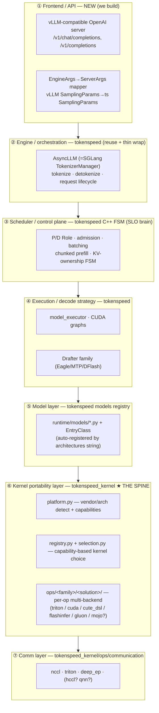

# UnieInfra — Component Architecture & Extension Map

Status: **Draft** · Date: 2026-07-24 · Owner: royshih

## Product definition (the north star)
- **UX:** as easy as vLLM — vLLM-compatible API / config / launch.
- **Performance:** push the whole latency–throughput Pareto out; formally **maximize RPS subject to SLO** (`max RPS s.t. TTFT_p99 ≤ X ∧ TPOT_p99 ≤ Y`).
- **Hardware-universal:** NVIDIA datacenter (B200/H100/H200) **and** sm_120 workstation (RTX PRO 6000/50-series) **and** AMD (MI300/MI355X/RDNA) **and future** Ascend, Qualcomm, …
- **Base:** the TokenSpeed engine core (C++ FSM scheduler + capability-based kernel registry), fronted by a vLLM-compatible adapter. TileRT is not a code dependency (closed B200 binary); its ideas inform the low-latency path.

The universality goal makes **one component the spine of the whole product: the kernel portability layer.** ~90% of hardware-expansion work lives there.

---

## The component stack

Request path: client → **①** → **②** `AsyncLLM.generate_request` → **③** C++ scheduler decides each step → **④** forward+sample (+drafter) → **⑤** model defines the graph → **⑥** every op dispatches to a hardware-specific kernel → **⑦** cross-GPU comm.

---

## Component-by-component: responsibility · location · what we extend

| # | Component | tokenspeed location | We reuse / extend / build |
|---|---|---|---|
| ① | **Frontend / API** | *(not in repo — upstream uses external `smg` gateway)* | **BUILD NEW.** vLLM OpenAI server + arg/sampling adapters over `AsyncLLM`. This is the "as easy as vLLM" work. Includes **auto-detecting single- vs multi-GPU topology** and configuring parallelism/comm with zero config (vLLM-style) — the engine should never require the user to say single vs multi card. |
| ② | Engine / orchestration | `runtime/engine/async_llm.py` (`AsyncLLM`), `llm.py`, `input_processor.py` | Reuse; add a thin vLLM `AsyncLLMEngine`-shaped wrapper. |
| ③ | **Scheduler / control plane** | `tokenspeed-scheduler/csrc/{fsm,scheduler}` · `operations/forward.cpp:947` | Reuse; **EXTEND for SLO** — admission/priority policy that maximizes RPS@SLO; P/D routing for low- vs high-concurrency. |
| ④ | **Execution / decode strategy** | `runtime/execution/model_executor.py` · `drafter/base.py:39` · `DRAFTER_MAPPING` | Reuse; **EXTEND** — speculative/MTP decode = TTFT/TPOT lever (new `BaseDrafter`). |
| ⑤ | **Model layer** | `runtime/models/*.py` + `registry.py` (auto-collects `EntryClass`) | **EXTEND** — add models (e.g. `gemma.py` + `EntryClass`). |
| ⑥ | **Kernel portability layer ★** | `tokenspeed_kernel/platform.py` · `registry.py` · `selection.py` · `ops/<family>/<solution>/` | **THE spine — EXTEND per hardware.** Every new accelerator plugs in here. |
| ⑦ | **Comm layer** | `tokenspeed_kernel/ops/communication/{nccl,triton,deep_ep,...}.py` | **EXTEND per interconnect** (PCIe/NVLink/xGMI/HCCL/…). |

---

## Where each "thing we want to build" lands (the extension map)

| Thing to build | Component | Concrete seam |
|---|---|---|
| vLLM API/config/launch parity | ① Frontend | new `unieinfra/frontend/` over `AsyncLLM.generate_request` |
| Best RPS@SLO scheduling | ③ Scheduler | `forward.cpp` admission/priority; SLO-aware policy |
| Lower TTFT | ③ + ④ | P/D split, chunked prefill; fast prefill kernels (⑥) |
| Lower TPOT | ④ Execution | drafter/MTP + tuned decode kernels (⑥) |
| New model (Gemma, …) | ⑤ Model | `runtime/models/gemma.py` + `EntryClass` |
| **New hardware backend** | ⑥ Kernel + ⑦ Comm | `platform.py` vendor/arch profile + capability tags + `ops/<family>/<solution>` kernels + comm backend |
| Peak-perf portable kernels | ⑥ Kernel | new `ops/<family>/mojo.py` solutions (Mojo/MAX) |
| **Kernel-system design rules + porting plan** | ⑥ Kernel | `kernel-system-design-principles.md` — the three TokenSpeed-Kernel principles, the cross-engine comparison (lmdeploy/sglang/tokenspeed/TileRT → vLLM), and Steps A–F for landing them |

**Read this twice:** hardware universality = almost entirely component ⑥ (+⑦). Models = ⑤. UX = ①. Performance = ③+④ (policy) feeding ⑥ (kernels). These are cleanly separated — which is exactly why tokenspeed is a good base.

---

## Hardware portability tiers (honest effort per accelerator)

The spine (⑥) already models `vendor ∈ {nvidia, amd}` and selects kernels by `CapabilityRequirement`. Adding a hardware = (a) a `platform.py` vendor/arch profile + feature flags, (b) capability-satisfying kernels per op family, (c) comm backend. Effort depends on whether a **portable kernel language reaches that hardware**:

| Tier | Hardware | Kernel path | Effort | Notes |
|---|---|---|---|---|
| **A** | NVIDIA datacenter (B200/H100/H200) | native tcgen05/CuTe + flashinfer + Triton | **already there** (upstream) | Extreme-perf home; MLA/MoE flagships (GLM-5/Kimi/DeepSeek) live here. |
| **B** | NVIDIA sm_120 (RTX PRO 6000/50) | Triton (functional) → tuned sm_120 later | **Low–Med** | See `tokenspeed-sm120-support.md`. Functional via Triton fallback; extreme needs tuned kernels. GQA models (Qwen/Llama/Gemma) only. |
| **C** | AMD (MI300/MI355X CDNA, RDNA) | Triton + Gluon (`ops/*/gluon/`) + `tokenspeed-kernel-amd` (pure Triton) | **Med** | ROCm; already partially present. RDNA (consumer) less covered. |
| **D** | **Ascend / Qualcomm / other NPUs** | ❌ **NOT CUDA/ROCm/Triton** | **High (new backend)** | The hard part of "universal". |

### The Tier-D reality (Ascend, Qualcomm)
Triton covers NVIDIA + AMD only. **Ascend (Huawei CANN/AscendCL, `torch_npu`) and Qualcomm (Hexagon/QNN) are entirely different stacks** — they cannot run CUDA/ROCm/Triton kernels. Supporting them means, per op family, a **new `<solution>` backend** written against the vendor toolchain (or dequant-to-native-op fallbacks), plus a new `platform.py` vendor branch and a new comm backend (e.g. Ascend HCCL). This is a **multi-quarter portability program**, not a config flag. Two strategic options:
- **Per-vendor native kernels** — maximal perf, maximal maintenance (one kernel set per accelerator).
- **A portable compiler that targets NPUs** — this is the strategic case for **Mojo/MAX** (⑥ as `mojo.py` solutions): one kernel source, multiple backends, aligned with the universality goal. Still an investment, but amortized across accelerators.

**Recommendation:** land the abstraction now (Tiers A–C prove the ⑥ spine works across NVIDIA+AMD), design ⑥'s solution/capability API to not assume CUDA, and treat Tier-D as a deliberate later program — with Mojo/MAX evaluated as the portable-kernel bet for NPUs.

---

## Sequencing (so components come online in dependency order)
1. **⑥ sm_120 correctness** (Tier B functional) — unblocks running on the dev box. → `tokenspeed-sm120-support.md`
2. **① vLLM frontend adapter** — the "as easy as vLLM" surface.
3. **⑤ model set** — Qwen/Llama present; add Gemma.
4. **Benchmark harness** — RPS@SLO Pareto vs vLLM (the product KPI + regression gate).
5. **③/④ SLO scheduling + MTP** — push the Pareto.
6. **⑥ tuned kernels per tier** (sm_120, AMD) — extreme perf; Mojo evaluation.
7. **Tier-D program** (Ascend/Qualcomm) — the universality endgame.
