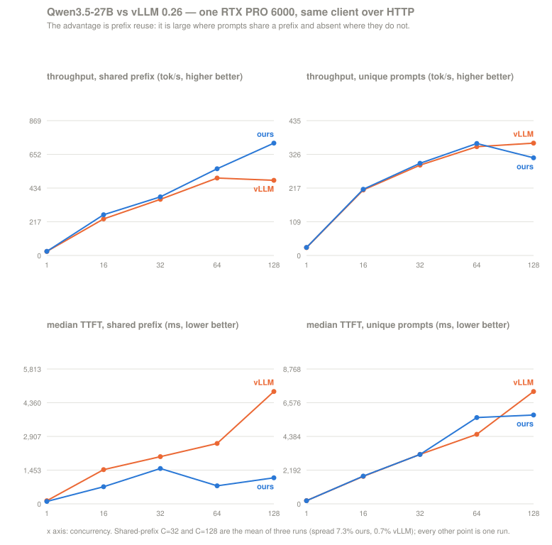
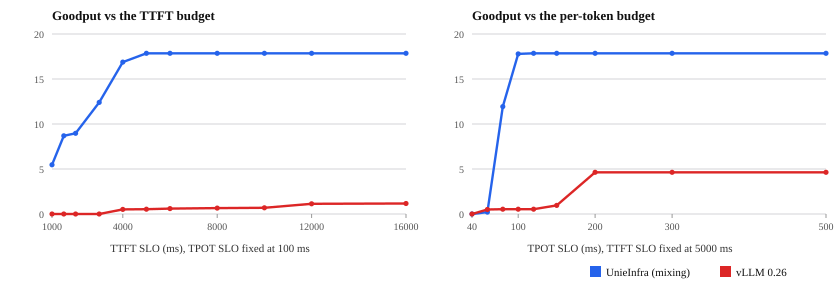

# Qwen3.5-27B against vLLM 0.26

Measured 2026-08-13 on one RTX PRO 6000 Blackwell (sm_120, HBM peak 1792 GB/s),
both engines driven by the same client over HTTP, a cold server per arm.
Build `f162d993` (branch `unieai`); see *Known defects* for the one file in it
that is not committed.

**This report describes `f162d993` and cannot be reproduced on current `unieai`.**
The tree has since merged 184 upstream commits (`7471e09c`), which deleted the
radix prefix-cache subsystem and, with the fork's scheduler config, the
`--mixed-prefill-decode-min-load` flag that every `mix` row below depends on.
Upstream's mixing is a plain boolean with no threshold, so the 1086.8 tok/s
figure is not a target the current tree can be measured against — it is a
different configuration, not a regression. The post-merge ladder is being
rebuilt separately and stood at 511.86 tok/s on this arm at the time of writing,
against the 754.0 `nomix` figure here. Read the numbers below as a record of
what that build did, not as a bar the present one is failing to clear.

## The finding in one line

**The advantage is prefix reuse, and one scheduler flag roughly doubles it.**
Mixing prefill and decode in the same step (`--mixed-prefill-decode-min-load 0`)
takes reuse at concurrency 128 from 66.5% to 85.8% and throughput from 754 to
1087 tok/s — **2.30x vLLM**, against 1.60x without it. Where prompts do not
share a prefix the same flag is worth nothing and costs 16%, and the two engines
are within 3% of each other up to concurrency 64.

That is a narrower claim than "faster", and it is the one the measurements
support. It also says where the remaining work is.

## How it was measured

| | |
|---|---|
| client | `vllm bench serve --backend openai-chat --endpoint /v1/chat/completions` — vLLM's own harness, **the same binary against both engines**, over HTTP |
| request shape | `--sharegpt-output-len 64 --num-prompts N --max-concurrency C --ignore-eos --seed 1`, `N = max(32, 2C)` |
| ours (`nomix`) | `tokenspeed.cli serve --max-model-len 8192 --gpu-memory-utilization 0.80 --max-num-seqs 452 --enable-mixed-batch` |
| ours (`mix`) | the same, plus `--mixed-prefill-decode-min-load 0` |
| vLLM | `vllm serve --max-model-len 8192 --gpu-memory-utilization 0.80 --max-num-seqs 452 --enable-prefix-caching` |
| model | Qwen3.5-27B, bf16 (64 layers: 48 gated-delta-net, 16 full attention) |

`--enable-prefix-caching` is passed to vLLM explicitly and its resolved value
checked in the running config: on Qwen3.5 hybrids it otherwise resolves to
`False` and says nothing, and a comparison run at vLLM's defaults measures vLLM
with its cache switched off.

`--enable-mixed-batch` is on in **both** of our arms, and it is not the flag
that does the work — its gate never fires at these concurrencies (see *Why
`--enable-mixed-batch` was inert*). The `nomix` rows are what that flag actually
delivers today.

In-process benchmarking was not used. This repository's own
`unieinfra/bench/e2e_concurrency.py` reported us 1.5–2.6x ahead on these shapes;
the same models under `vllm bench serve` reported the opposite. The in-process
numbers were honest about their conditions, and those conditions were not
serving.

## Two workload shapes

**Shared prefix (`rag`)** — 16 documents, several questions each. 90.8% of every
prompt's characters are shared with an earlier prompt. Prompts are 606–1015
tokens. For the 64 prompts actually sampled, an oracle with an infinite cache
could reuse 84.1% of all prompt tokens if requests arrived strictly in sequence,
74.4% given the prefill batching this engine performs *without* mixing, and
37.6% if all 32 concurrent requests were blind to one another.

This is the one-document-many-questions shape: RAG, document QA, a long shared
system prompt, an agent loop with a fixed tool preamble. 90.8% is the optimistic
end of it — real retrieval varies the context per query and shares less, which
moves a deployment toward the `chat` rows below.

**Unique prompts (`chat`)** — the same client and parameters against a corpus
with 0.0% shared prefix by construction. This is the shape where a prefix cache
is worth nothing, so whatever margin survives here is the engine.

## Shared prefix

| C | nomix | mix | vLLM | mix vs vLLM | reuse nomix → mix |
|---:|---:|---:|---:|---:|---|
| 1 | 26.6 | 26.6 | 25.9 | 1.03x | 72.1% → 72.1% |
| 16 | 270.3 | 292.0 | 236.3 | **1.24x** | 47.7% → 63.5% |
| 32 | 384.6 | 453.6 | 359.8 | **1.26x** | 40.8% → 64.6% |
| 64 | 560.8 | 749.8 | 498.8 | **1.50x** | 50.1% → 76.9% |
| 128 | 754.0 | **1086.8** | 471.5 | **2.30x** | 66.5% → **85.8%** |

**2.30x is the top of a monotone curve, not a flat property of the engine.** At
C=32 it is 1.26x; at C=1 there is nothing queued to mix and nothing to gain.
Mixing's own contribution rises the same way: 1.00x, 1.08x, 1.18x, 1.34x, 1.44x.

Latency at C=128, mix against vLLM: median TTFT 1681 vs 4666 ms (2.8x), mean ITL
78.3 vs 152.7 ms (2.0x), P99 ITL 350 vs 1224 ms (3.5x).

The C=128 mix arm was run three times: 1110.2 / 1118.9 / 1113.2 tok/s, **spread
0.78%**, reuse 86.3 / 86.5 / 86.4%. vLLM repeats to 0.2%. Every other cell in
both ladders is a single run.

### Why mixing wins here and loses on unique prompts

One mechanism explains both signs: **how much work one weight read buys.** A
step must read all 55.6 GB of weights whatever else it carries.

- On unique prompts a pure-prefill step packs ~5464 tokens into that read. A
  mixed step spends the same read on 128 decode tokens plus ~735 prefill tokens.
  Six times less work per read, so mixing loses.
- On shared prefixes most prompt tokens are cache hits, so prefill is nearly
  free and decode dominates. Mixing amortises the read across both, so it wins.

The gain is therefore mostly a **cache** effect, not a scheduling-efficiency
one. Mixing spreads prefill across more steps, so a later prompt sees the cache
the earlier one just wrote; without it, eleven prompts prefill in the same step
blind to each other. That is the oracle table above — 84.1% sequential, 74.4%
batched, 37.6% blind — and **85.8% is past the 74.4% line because mixing changes
the batching structure that line was computed from.**

**So the gate is reading the wrong signal.** `forward.cpp:1230` decides on queue
depth. What decides the sign is how expensive the pending prefill is, and
`AdmitChunk` already knows each chunk's cached/new split.

## Unique prompts

| C | nomix | mix | vLLM | nomix vs vLLM |
|---:|---:|---:|---:|---:|
| 1 | 25.9 | 25.8 | 25.2 | 1.03x |
| 16 | 214.6 | 214.4 | 211.1 | 1.02x |
| 32 | 296.5 | 292.4 | 290.8 | 1.02x |
| 64 | 363.5 | 347.4 | 351.9 | 1.03x |
| 128 | 311.1 | 260.2 | 360.0 | **0.86x** |

Parity to concurrency 64, then a 14% loss at 128 — and mixing makes it worse
(0.84x of `nomix`). Without a prefix to reuse, mixing is pure overhead.

**This loss is not fixed.** The section below attributes it to a two-slot
recurrent reservation per request, which halves the concurrency the pool can
sustain; raising the memory budget clears it (−1.6% at GMU 0.90) but that is
working around the reservation, not removing it. At the budget this ladder was
run at, the engine still loses 14% here.

## Why `--enable-mixed-batch` was inert

The flag is on every arm of this ladder and its gate never fired once.
`forward.cpp:1230-1238` computes `load = waiting / max_batch_size` against
`mixed_prefill_decode_min_load` (0.35), with `max_batch_size = max_num_seqs =
452`. Read out of the runs' own logs, the deepest queue was 106 (unique) and 116
(rag) — **load 0.235 and 0.257**, under the threshold. `types.h:139-142` records
the calibration as "0.16-0.27 at 128 concurrent ... so 0.35 sits in a clean gap",
so the threshold was set deliberately not to fire at 128. Below C=64 the queue
is empty and the gate early-returns, correctly.

`types.h:150-154` records always-mixing losing badly on RAG — 223 against 390
tok/s at C=64. That measurement stands at its own operating point; at C=128 the
sign reverses. The note needs updating, not deleting.

Bounding prefill's share **without** turning mixing on is worse than either
(288.7 tok/s, −8.3%): `mix_this_step` is still false, so the `break` at
`forward.cpp:1371` still drops every decode row on any prefill step, and the
caps only make prefill take more steps to hit it.

## The C=128 unique-prompt loss: over-admission, and what it costs here

The engine admits far more work than can be resident. `#queue-req` is
`Scheduler::WaitingSize()` (`scheduler.cpp:249`), so the ~23 requests sitting
there are admissible ones being refused, every step, while the batch runs short.
The ceiling scales with the recurrent pool:

| arm, C=128 unique | `mamba_pool_total_chunks` | running max | tok per prefill step | tok/s |
|---|---:|---:|---:|---:|
| baseline (GMU 0.80) | 221 | 80 | 1702 | 314.8 |
| `--no-enable-prefix-caching` | 221 | 93 | 1716 | 320.8 |
| `--mamba-full-memory-ratio 4.0` | 264 | 94 | 2233 | 323.9 |
| `--gpu-memory-utilization 0.90` | 306 | **128** (saturated) | **5191** | **394.2** |

A 19.5% larger pool buys a 17.5% higher ceiling — a constant ~0.36 running
requests per chunk, i.e. **~2.8 chunks per in-flight request**. `--max-num-seqs
452` is fiction; at GMU 0.80 the sustainable ceiling is ~80. The excess requests
churn in admission and collapse the prefill batch from 6235 tokens at C=64 to
1702, and a one-sequence prefill step pays the same weight read as an
eleven-sequence one. That is where the throughput goes.

**Where the 2.8 comes from: a request reserves two recurrent slots, not one.**
`constexpr std::int32_t kLocalMambaSlotsPerRequest = 2`
(`scheduler/operations/forward.cpp:67`), with `mamba_slots_needed = 2 +
mamba_loadback_slots_needed` at admission (`:552`) and an unconditional guard
`AvailableSlots() < kLocalMambaSlotsPerRequest` at `:571` and `:820`. One slot
is the working state; the second is reserved for the snapshot the request will
publish as a copy-on-write source. The measured ceiling is then
`chunks / 2` minus whatever the radix cache is holding, which is what the four
arms show:

| chunks | `chunks / 2` | running max | held by the cache |
|---:|---:|---:|---:|
| 221 (cache on) | 110 | 80 | 30 |
| 221 (cache off) | 110 | 93 | 17 |
| 264 | 132 | 94 | 38 |
| 306 | 153 | **128** (saturated) | — |

GMU 0.90 works only because 306/2 = 153 clears 128. **The second slot is charged
even when it can never be used**: the `:571` and `:820` guards are gated on
`mamba_allocator_` alone, not on whether prefix caching is on, so the unique
shape — where reuse is 0% by construction and every published snapshot is dead
weight — pays the same halving as the shape that benefits. The constant carries
no comment recording why it is 2, and there is no runtime override.

That makes the C=128 unique loss a one-constant problem rather than a
memory-budget one, and the experiment is correspondingly small: make the
reservation 1 when prefix caching is off (or when the request will not publish),
and the ceiling at 221 chunks should move from ~93 toward ~180. It has not been
run here — the change is in the C++ scheduler extension, and everything in this
report was measured against the shipped `sched.so`.

It is **not** KV (page ratio peaks at 0.68 of 8244 pages) and **not** retained
snapshots (turning the prefix cache off changes almost nothing, 320.8 vs 314.8),
so the ~2.8 chunks are structural.

**Giving the pool room nearly removes the gap**, but the budget has to move for
both engines:

| C=128 unique | GMU 0.80 | GMU 0.90 |
|---|---:|---:|
| ours | 314.8 | 394.2 |
| vLLM | 362.1 | 400.8 |
| | **−13.1%** | **−1.6%** |

So most of the −13.1% is the memory budget, not the engine: at 0.80 our
recurrent pool cannot sustain 128 in flight and vLLM's can. GMU 0.94 OOMs, so
0.90 is the practical ceiling on this card and the headroom is thin.

**The other fix — capping admission — does not transfer to this model.** On
gemma-4-31B the same symptom is far louder: the KV pool holds about 30 sequences
against `--max-num-seqs 452`, and lowering the limit to what the pool holds
moved that model from 219.6 to 340.4 tok/s (+55%), its P99 ITL from 1905 to
155 ms, and its median ITL below vLLM's. On Qwen3.5-27B the mismatch is 80
against 128, not 30 against 452, and capping to 80 **loses**: 282.4 tok/s on the
unique shape (−10.3%) and 829.8 on rag with mixing (−25.3%), buying a 3.8x
better P99 ITL and a much worse TTFT. Same mechanism, opposite prescription —
the remedy's sign tracks how large the mismatch is. What both models do share is
that vLLM refuses to start in this situation and names the number to use, while
we accept it and stall at runtime; a startup guard is right regardless.

## Scored as goodput, the picture changes — in both directions

Throughput alone is the wrong objective for a serving comparison. Scored with
`vllm bench serve --goodput ttft:2000 tpot:100` (the client computes it, so both
engines are held to the same rule), shared prefix at C=128:

| | tok/s | median TTFT | P99 ITL | **goodput (req/s)** |
|---|---:|---:|---:|---:|
| ours, mixing | 1139.2 | 1626 ms | 282 ms | **8.90** |
| vLLM | 480.2 | 4858 ms | 1235 ms | **0.00** |

vLLM's median TTFT is more than twice the 2 s SLO, so no request qualifies and
its goodput is zero. **That is a degenerate ratio, not a "we are infinitely
faster" claim**, so the SLO was swept instead. Goodput is computed client-side
from per-request measurements — a request counts only if *every* SLO holds for
it (`serve.py:643`, `all([s >= r ...])`) — so one `--save-detailed` run per
engine produces the whole curve without re-running a server per threshold.

| TTFT SLO (ms), TPOT ≤ 100 ms | 1000 | 2000 | 4000 | 8000 | 16000 |
|---|---:|---:|---:|---:|---:|
| ours | 5.39 | 8.85 | 16.66 | 17.63 | 17.63 |
| vLLM | 0.00 | 0.00 | 0.50 | 0.65 | 1.15 |

| TPOT SLO (ms), TTFT ≤ 5000 ms | 60 | 80 | 100 | 150 | 200 | 500 |
|---|---:|---:|---:|---:|---:|---:|
| ours | 0.21 | 11.82 | 17.63 | 17.70 | 17.70 | 17.70 |
| vLLM | **0.50** | 0.53 | 0.53 | 0.94 | 4.59 | 4.59 |

**The binding SLO is TPOT, not TTFT.** Only 39 of vLLM's 256 requests hold a
100 ms per-token budget (median TPOT 158.8 ms) against 255 of 256 for us
(median 77.5 ms), which is why loosening TTFT to 16 s still leaves it at
1.15 req/s. The advantage is therefore band-dependent, and the honest summary is
the shape of the curve rather than any single number: **~33x in the 80–150 ms
TPOT band, settling to 3.9x once the SLO stops binding, and at a 60 ms budget
neither engine delivers much and vLLM is marginally ahead.**

The same lens is much less flattering on the unique-prompt shape at C=128:

| | tok/s | P99 ITL | meets P99 < 1500 ms |
|---|---:|---:|---|
| ours, `nomix` (the configuration this report ships) | 311.1 | 4938 ms | **no** |
| ours, mixing | 260.2 | 1236 ms | yes |
| vLLM | 360.0 | 1212 ms | yes |

**The published default delivers zero goodput at any reasonable tail SLO here.**
The only configuration of ours that qualifies is the mixing one, and against
vLLM that is −27.7%, not the −14% the throughput row shows. Under a goodput
objective the C=128 gap is *larger* than this report otherwise claims, and
mixing should be the default on this shape rather than the flag that costs 16%.

That also changes what the mixing gate should read. Queue depth is wrong, and so
is "how expensive is the pending prefill" on its own: the question is whether
skipping the mix pushes in-flight requests out of their latency budget.

## Output, not just latency

A latency number cannot tell a working decode from a broken one, and token
identity is the wrong test — this engine's own fp8 KV work records that for a
lossy path, identical tokens are not what success looks like. So the check is
scored answers: 40 questions with unambiguous short answers, each behind a fixed
~700-token shared preamble so the request is on the prefix-reuse path, greedy,
three repeats, run concurrently.

| arm | score |
|---|---|
| C=1 reference | **120/120** |
| C=120, mixing | **120/120** |

**Quality under load is unchanged.** The generated *text* does diverge — against
a C=1 reference, 81/128 completions are identical without mixing and 60/128 with
it, agreeing for ~140 characters before splitting — but that is what the next
section says any prefix cache does, and mixing raises reuse, so it happens more.
It changes wording, not answers.

(The first version of this check scored 0/120: Qwen3.5 emits a "Thinking
Process:" preamble that consumed the whole 48-token budget before any answer
appeared. Scored with `chat_template_kwargs: {"enable_thinking": false}`.)

## Against the roofline

Comparing only against another engine cannot say when a kernel is finished. A
decode step must read the model's weights once, so `weights / HBM peak` is a
floor that does not move:

| | roofline | measured | achieved |
|---|---|---|---|
| Qwen3.5-27B decode step, C=1 | 31.0 ms (55.6 GB) | 35.0 ms | **88%** |
| Qwen3.5-27B decode step, C=32 | 31.0 ms | 51.0 ms | 63% |
| prefix reuse, shared prefix at C=32 | 74.4% | 64.6% (mix) | **87%** |

At C=1 decode is within 12% of the physical limit, so there is little left in
the decode kernel itself. The room is in reading fewer bytes (weight
quantisation moves the 31.0 ms floor to ~15.6 ms at fp8), emitting more tokens
per read (the checkpoint carries `mtp.*` weights and the drafter exists, but no
arm here enables speculative decoding), or amortising the read over more rows —
which is exactly what the recurrent-pool ceiling above caps.

Reuse at C=32 was the number with room in it. Mixing took it from 55% of that
ceiling to 87%.

## Known defects, and what they cost this report

**A cached answer is not bit-identical to a cold one, and that is expected.**
A prefix hit and a cold prefill differ in the first generated token's logprob by
0.04-0.07 at some prompt lengths, enough to flip the argmax and return different
text. This was initially diagnosed as a precision defect in the recurrent
snapshot: the state pool is bf16 while a cold prefill carries its state in an
fp32 accumulator, and round-tripping through bf16 moves the state by 2.3e-03 in
an isolated kernel probe. That diagnosis is **wrong**, and the control that
retires it is a dense model. Qwen3-0.6B has no recurrent layer to snapshot at
all, and shows a perturbation of the same relative magnitude. Storing the
snapshot in fp32 -- or running the entire recurrent path in fp32 -- changes the
end-to-end numbers not at all, to six decimal places. What remains is what any
prefix cache does: attention over restored KV, and a different token count per
forward changing the reduction order inside the GEMMs. vLLM's cache carries the
same property. The isolated probe measured a real mechanism that is not the
cause of the observed effect.

**The fp32 checkpoint pool crashes under concurrency.** With
`--enable-mamba-ckpt-pool --mamba-ckpt-dtype float32` the server resolves the
flags on, allocates (22 slots, 3.30 GB), answers single requests — and then dies
on the first concurrent load with `Assertion '-sizes[i] <= index && index <
sizes[i] && "index out of bounds"' failed` (26 times) followed by a CUDA
device-side assert. It reproduces with mixing (`causal_conv1d_fn`,
`hybrid_linear_attn.py:2825`) and without it (`_plan_paged_extend`,
`flashinfer/__init__.py:810`). Every arm in this report therefore ran with
`enable_mamba_ckpt_pool=False`. Given the retraction above the pool is no longer
needed for output correctness, but it is a live crash. Note that its sizing
code, `layers/attention/registry.py`, is the one file in this measurement that
is **not committed**.

**Enabling that pool also costs concurrency, measured.** It took
`mamba_pool_total_chunks` from 221 to 177, −19.9%. At ~0.36 running requests per
chunk that is ~16 fewer in-flight requests, so it trades directly against the
C=128 ceiling above.

**Three fixes were tried and none worked. Recorded so they are not retried.**

- *Halving the per-request recurrent reservation.* `kLocalMambaSlotsPerRequest`
  2 → 1, built from a scratch copy of the scheduler and loaded through
  `SCHED_SHIM`. **No effect**: 311.3 against a same-source control's 309.5 tok/s
  (+0.6%, inside noise) and the in-flight ceiling did not rise (91 against 96).
  The `chunks / 2` relation fits five pool sizes but is not causal. The control
  earned its cost: a fresh build alone moved the ceiling 80 → 96, so without it
  that +16 would have been credited to the patch. The remaining candidate is
  `mamba_slots_needed = 2 + loadback` at `forward.cpp:552`, and the next step is
  to measure who actually holds the 221 chunks rather than guess again.
- *MTP speculative decoding.* Two independent blockers. The recurrent pool is
  sized `max_req_pool_size x (1 + num_draft_tokens)`
  (`hybrid_linear_attn.py:508`), so enabling it asks for **100.05 GiB** and OOMs;
  `--max-mamba-cache-size` does not cap that, `--max-num-seqs 64` does. Past
  that it is refused outright: `--enable-mixed-batch requires an attention
  backend that can serve mixed batches; HybridLinearAttnBackend declares
  supports_mixed_batch = False`. With the flag removed from the harness it still
  fails, on `AssertionError: Mask is required for speculative decoding`. **So
  MTP and the mixing win above cannot currently be stacked**, and MTP does not
  run on this model at all.
- *Tensor parallelism.* `--tensor-parallel-size 2` aborts at startup with
  `CUDART error: peer access is not supported between these two devices`, and
  `--disable-custom-all-reduce` does not avoid it, so the P2P assumption is
  earlier than the all-reduce choice. An earlier TP arm that also carried the
  mixing flags died instead on an illegal memory access inside
  `sampling/triton/common.py:158`; that was attributed to the sampler before the
  clean arm showed the P2P cause, and the attribution was wrong. This is a
  topology limit on this box (no NVLink between these cards) plus code that
  assumes P2P, not a kernel defect.

**One dataset per shape, one output length, one memory budget for the ladder.**
Every request emits exactly 64 tokens under `--ignore-eos`, which weights the
comparison toward prefill-dominated behaviour — on the rag shape 93% of the
tokens moved are prompt tokens. Long-output and multi-turn shapes are unmeasured.
The GMU 0.90 rows are separate arms, not a second ladder.

**Repeat spread is a property of the configuration, not of the engine.** This
report previously quoted 7.3% for us against 0.7% for vLLM. That was measured on
the *no-mixing* rag configuration; mixing removes the limit cycle behind it and
repeats to 0.78%, and a unique-shape baseline arm reproduced its published
number to 0.06% (314.82 against 314.62 tok/s). Derive sigma per configuration
before using it as a threshold.

**Our reuse counter is still not reachable.** `--enable-metrics` is on by default
and `tokenspeed:prefix_cache_hits / prompt_tokens` is the same ratio vLLM
publishes, but the smg Prometheus exporter binds a random free port and
`TOKENSPEED_SMG_PROMETHEUS_PORT` does not reach the `tokenspeed.cli serve` entry
point, so the reuse column is aggregated from the engine's own `#cached-token` /
`#new-token` per prefill batch.

## Reproducing

The harness is `.cq.sh` (rag) and `.cq_uniq.sh` (chat) in the workspace root
(not in this repository), driven per shape by `.ladderX.sh`: it starts a cold
server per arm, derives its port from the run tag so parallel runs cannot answer
each other's requests, records branch, HEAD and the md5 of the installed
scheduler extension before each arm, and kills only the engine tree it started.

A cold server per arm is what makes the rung order irrelevant on the rag shape.
That corpus shares one document across the whole process, so a harness reusing
one server measures a different thing at C=16 depending on which rungs ran
before it — 736 against 907 ms on the same build.

One thing it cannot do for you: the scheduler extension is chosen per model from
the checkpoint's `architectures` (see `flat_kvcache_select.py`). Qwen loads the
radix build. Running these arms against the flat build instead drops throughput
to 361.8 tok/s at C=64 and takes prefix reuse to exactly zero — the state group's
page grain lifts the global block size to 400, prompts of ~830 tokens end
mid-page, and no snapshot is ever registered.

Output is scored by `.qcheck.py` (checkable answers under load) and captured by
`.outcheck.py` (raw completions for a text diff), both in the workspace root.
